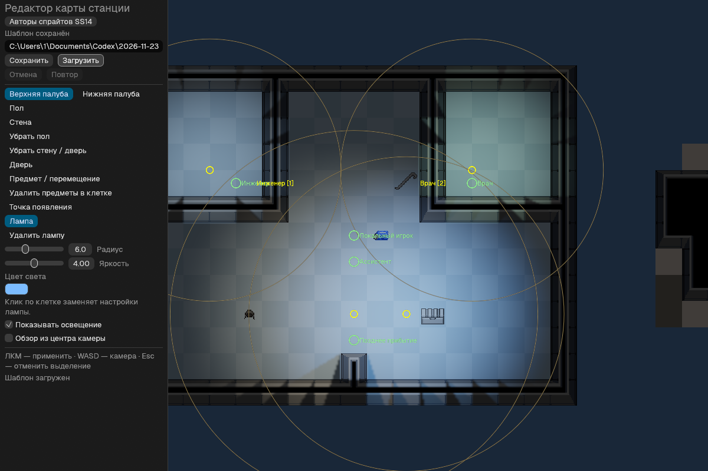

# Свет, соединение стен и устранение пауз — 23 ноября 2026

Основная найденная причина зависаний: световое поле 256×256 пересчитывалось
синхронно на CPU в `Renderer::update_light`. Для каждой точки выполнялись
обходы вокселей до наблюдателя и ламп, затем фильтр. Движение и изменение двери
запускали этот расчёт в потоке окна. Предыдущее увеличение разрешения усилило проблему.

Теперь `station_light_gpu.rs` подготавливает компактную сетку препятствий и
источники, а `station_light_gpu.wgsl` параллельно рассчитывает поле 512×512.
CPU не ждёт завершения этого прохода; последующая отрисовка упорядочена той же
GPU-очередью. Кэширование по геометрии, палубе, источникам и положению сохранено.
`station.wgsl` восстанавливает свет кубическим B-spline фильтром по 16 соседям:
границы непрерывные, без крупных квадратов прежней карты. Это сглаживание
точечных теней, а не физические полутени от площадных источников.

## Измерения

Одинаковая карта, debug-сборка, редактор и два независимых TCP-клиента,
5 ламп, открытие дверей, предметы в руках, движение врача. Это локальный
диагностический прогон, не обещание определённого FPS на другом компьютере.

| Измерение | Результат |
|---|---:|
| Прежний CPU-пересчёт света, 7 вызовов | 181,78–299,49 мс; медиана 203,52 мс |
| Новая CPU-подготовка и отправка GPU-команд, 7 вызовов | 0,48–1,19 мс; медиана 0,60 мс |
| Отрисовка инженера, 1453 вызова | медиана 4,45 мс; p95 5,22 мс; максимум 39,61 мс |
| Отрисовка врача, 1665 вызовов | медиана 4,50 мс; p95 5,33 мс; максимум 21,13 мс |

Время новой подготовки **не включает выполнение compute на GPU**. Время
отрисовки замерено вокруг `draw_with_peers`, включает отправку команд и
ожидание поверхности, исключает кадры записи PNG. Это не GPU timestamp query
и не полная задержка ввода. Холодные кадры не исключались; максимум приведён
отдельно. Нагрузочный сценарий с 32 лампами на большой карте не запускался.

Исходные записи: [до](evidence/sprites/light-before.log),
[после](evidence/sprites/light-after.log), [сводка JSON](evidence/sprites/PERFORMANCE.json).
Повтор: установите `STATION_PROFILE=1`, соберите workspace и запустите
`station/verify-sprites.ps1 -ScratchRoot <временный каталог>`.

## Соединение стен

Каждая стена собирается из четырёх прозрачных угловых RSI-слоёв. Проверяются
соседи по сторонам и диагонали: торцы, прямые участки, внешние и внутренние
углы, заполненные соединения. Вместо отдельных повторяющихся блоков получается
единая линия стены. При открытии двери или удалении блока пересобираются
затронутые чанки и соседи; при движении камеры меши остаются прежними.

Код: `../crates/horizon-client-render/src/station_renderer.rs`, функция
`wall_corner` и подготовка GPU-мешей. Текстуры остаются оригинальными SS14,
авторы и CC BY-SA 3.0 сохранены в [ATTRIBUTION.md](assets/ss14/ATTRIBUTION.md).

## Проверки

- 75 тестов workspace: render 13, client 6, server 15, sim 41.
- GPU-тест считывает настоящий RGBA32Float-результат и сравнивает 2883 точки
  с CPU-эталоном обхода клеток и затухания: проём, углы, наблюдатель на границе,
  разные цвета и режим без ограничения обзора; допуск 0,0001.
- Проверки вариантов углов стен и обновления соседних чанков.
- Clippy всех targets с `-D warnings`, сборка `--locked --offline`.
- Редактор сохраняет/загружает карту; два сетевых клиента открывают двери
  и достают предметы через UI. Закрытые двери скрывают персонажей, открытые
  показывают. Загрузок геометрии при движении камеры: 0.

Исправлена также гонка smoke-сценария: он ждёт появления реальной кнопки двери
после выхода из лобби, а не предполагает, что она уже была на предыдущем кадре.
Финальные проверки открытия двери и инвентаря сохранены.
