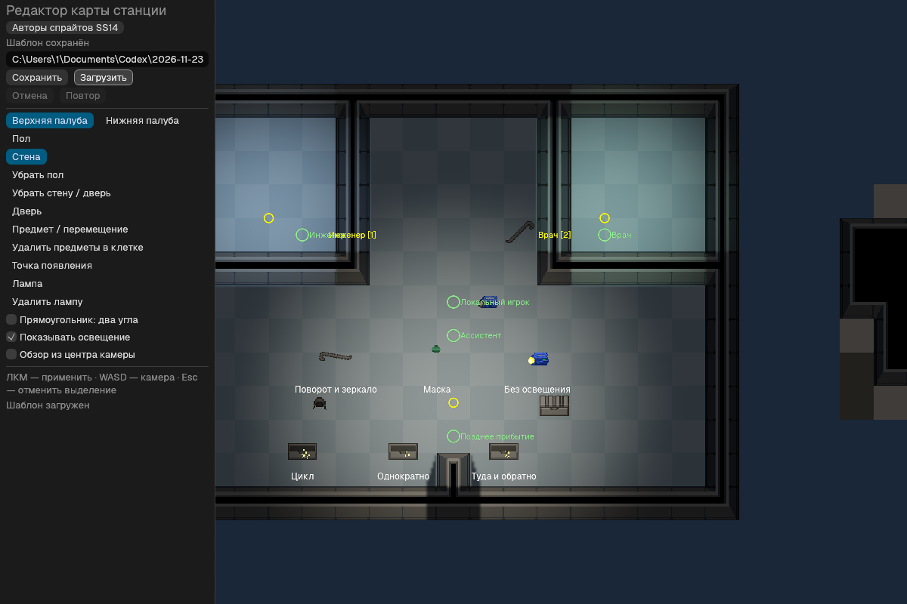

# Система спрайтов в формате Station

Реализован согласованный этап: система спрайтов в нашем JSON-формате, без
импорта YAML-прототипов и языка пользовательских шейдеров SS14. В игре работает
Rust-код; C# остаётся только эталоном проверки перенесённых алгоритмов.

## Возможности

| Область | Реализация |
|---|---|
| Ресурсы | RSI v1, 1/4/8 направлений, индивидуальные задержки направлений, именованные состояния, единый GPU-атлас |
| Компонент | Видимость, RGBA, смещение, масштаб, поворот, направление, запрет поворота с объектом, глубина, запрет зацикливания |
| Слои | Основной ключ и псевдонимы, вставка, замена, перемещение, удаление, копирование через Clone, пустые слои-заготовки |
| Геометрия слоя | Собственные цвет, масштаб, смещение, поворот в градусах, зеркальность по двум осям, смещение направления шагами 45° |
| Анимация | Индивидуальный курсор сущности/слоя, цикл, однократное воспроизведение, обратный ход, ping-pong, скорость, пауза, перемотка, перезапуск |
| Синхронизация | Необязательная общая фаза по серверному тику; обычные слои начинают с собственного первого появления |
| События | Изменение отображаемого кадра и завершение; чтение после draw из `sprite_runtime.events` |
| Внешность | Условия Appearance по строковым значениям и атомарные изменения именованных слоёв; пример — включение фонаря |
| Материалы | Обычное освещение или unshaded; альфа-маска из другого, в том числе скрытого, слоя |
| Выбор мышью | Преобразованный четырёхугольник, прозрачность текущего кадра, цветовая альфа и маска |
| Интерфейс | Составные иконки из всех видимых слоёв; кэш обновляется при изменении кадра или внешности |
| Ресурсы во время работы | F5 перечитывает `STATION_SPRITE_DIR` в игре и редакторе; ошибочная загрузка сохраняет предыдущий атлас |
| Сеть | Station v7 передаёт описание внешности и style; локальные курсоры не заменяют серверные проверки действий |

Одежда и руки получают стабильные префиксы ключей по слоту/руке. Добавление
одежды не сдвигает идентичность остальных именованных слоёв. Удалённые сущности
и слои освобождают курсоры; откат часов раунда очищает старые фазы.

## Формат

В прототипе предмета `sprite.layers` — базовые слои, `sprite.style` — параметры
компонента. У персонажа используются `character.layers` и `character.style`.
Существующие варианты `active_layers`, `open_layers`, `working_layers`,
`worn`, `inhand_left/right` продолжают работать.

```json
{
  "style": {"color": [1, 1, 1, 1], "scale": [1, 1], "no_rotation": true},
  "layers": [
    {"key": "cutout", "rsi": "human", "state": "head_m", "visible": false},
    {"key": "paint", "rsi": "wall", "state": "full", "mask": "cutout", "unshaded": true},
    {"key": "effect", "aliases": ["sparks"], "rsi": "crate", "state": "sparking",
     "looping": false, "playback_speed": 1, "rotation": 0, "mirror": [false, false]}
  ]
}
```

Для пустого слоя достаточно `{"key":"effect"}`. Правило внешности может позже
задать его `rsi` и `state`. Неизвестные реальные ресурсы обозначаются клеткой;
пустой слой ничего не рисует. Имена и псевдонимы уникальны внутри определения.

`animation_time` задаёт позицию перемотки в секундах. `auto_animated:false`
останавливает автоматический ход. Увеличение `restart` сбрасывает курсор.
`reversed:true` меняет направление, `cycle:true` включает ход туда и обратно,
`synchronized:true` привязывает фазу к общим часам. На точной границе задержки
сохраняется поведение SS14: переход происходит при отрицательном остатке времени.
Окончание one-shot останавливает курсор; для повторного запуска увеличьте `restart`.
Вне видимости обычные анимации не продвигаются; синхронные при появлении
возвращаются к общей фазе. При пропуске нескольких кадров событие Frame описывает
итоговый отображаемый кадр, а не каждый промежуточный кадр.

Пример правила (`sprite.rules`):

```json
[{"key":"activated","value":"true","layer":"lamp",
  "patch":{"state":"flashlight-on","unshaded":true}}]
```

Имя состояния должно существовать в выбранном RSI; смотрите реальные значения
в `content/station.json`. Встроенные данные Appearance: `activated`, `open`,
`held` со значениями `"true"`/`"false"`. API `SpriteComponent::appearance` принимает
произвольный словарь для других систем. Правила проверяются относительно базовых
слоёв. Если выбранный вариант не содержит цели правила, исходный вариант
сохраняется целиком. Невалидное изменение компонента не применяется частично.

Маска использует UV своего текущего кадра в координатах изображения целевого
слоя; её собственное геометрическое смещение не переносится на цель. Удаление
слоя маски очищает ссылки на него. Глубина слоёв дополняет существующий depth test
3D-мира: физическая высота и перекрытие стен сохраняются. Это адаптация к нашей
ортографической 3D-сцене, а не замена на отдельный 2D-рендерер Robust.

## Код

- `../crates/horizon-client-render/src/station_sprite_types.rs` — схема, ключи,
  псевдонимы, атомарные операции и Appearance.
- `../crates/horizon-client-render/src/station_sprite_runtime.rs` — курсоры,
  события, геометрия, маски, чтение пикселя и hit test.
- `../crates/horizon-client-render/src/station_sprite.rs` — RSI и атлас.
- `../crates/horizon-client-render/src/station_renderer.rs`, `station.wgsl` —
  GPU-слои, материалы, повторная загрузка, связь с 3D-сценой.
- `sim/src/appearance.rs`, `sim/src/content.rs` — серверная внешность и проверки.
- `client/src/sprite_icons.rs` — составные иконки с кэшем.
- `ss14-playback-rules/src/port.rs` — перенесённый алгоритм кадров.

API Runtime также предоставляет `frame`, `finished`, `restart`, `copy_animation`.
Операции со слоями доступны через `SpriteComponent::{insert,set,remove,move_layer}`.
Прямое редактирование публичных данных требует вызова `validate` перед использованием.

## Проверка и демонстрация

```powershell
cargo test --manifest-path station/Cargo.toml --workspace --locked --offline
cargo clippy --manifest-path station/Cargo.toml --workspace --all-targets --locked --offline -- -D warnings
cargo build --manifest-path station/Cargo.toml --workspace --locked --offline
station/verify-sprites.ps1 -ScratchRoot C:/path/to/scratch
station/verify-sprite-runtime.ps1 -ScratchRoot C:/path/to/scratch
station/ss14-port/verify-playback.ps1 -RustAnything C:/path/to/rust-anything.exe
```

Демонстрационная карта: `content/sprite-lab.json`. Её можно открыть редактором
через `--editor --content station/content/sprite-lab.json` в изолированном каталоге
запуска с абсолютным путём к файлу. `--map-output` задаёт отдельную копию для правок.
Сцена показывает поворот, зеркало, маску, unshaded и три режима анимации.
Скрипт проверки также заменяет атлас и проверяет отказ с сохранением прежнего
атласа для отсутствующего набора ресурсов.

Перенос `AdvanceFrameAnimation`: [425/425](ss14-port/PLAYBACK-GATE.json).
Ранее перенесённый `FoldDelays`: [358/358](ss14-port/SPRITE-GATE.json).
Происхождение и область C#-эталона: [PLAYBACK.md](ss14-port/PLAYBACK.md).
Результаты GPU-проверок и снимки: `evidence/sprite-runtime`, `evidence/sprites`.

Не входят в согласованный этап: загрузчик YAML SS14, транслятор её shader DSL,
цепочки экранных post-shader эффектов Robust и его ECS. В нашем формате
материалы ограничены освещённым/unshaded слоем и альфа-маской. RSI-атлас остаётся
2048×2048 с проверкой переполнения. Новая система может проигрывать ходьбу,
но импортированные ранее статические состояния человеческого тела не стали
анимациями ходьбы автоматически.

Итог проверки 23 ноября 2026: **85 тестов** (render 20, client 7, server 15,
sim 43), Clippy без предупреждений, debug-сборка. Оба сетевых клиента и
демонстрационная сцена завершились с кодом 0. После обновления составных иконок
у инженера измерены 1354 вызова отрисовки: медиана 3,67 мс, p95 5,45 мс,
максимум 33,20 мс; запись PNG исключена. Это локальный замер draw, а не обещание
FPS на другом оборудовании. Журнал: `evidence/sprites/engineer-error.log`.



## Масштаб как в SS14

Геометрия каждого слоя берётся из размера кадра RSI: `meta.size / 32` клетки.
`32×32` — одна клетка, `64×64` — две, `64×32` — две на одну.
Прозрачные поля не обрезаются и не растягиваются до заполнения клетки.
`character.sprite_size` и `prototype.sprite_size` теперь множители этого
естественного размера; нормальное значение `[1,1]`. Затем применяются
`layer.scale` и `style.scale`. Физические размеры Rapier независимы.

Убраны произвольные увеличения персонажа 1.2, ящика 1.3 и лабораторных объектов
2–2.5. Демонстрационный поворот и зеркало сохранены без увеличения предмета.
Для старого пользовательского RSI 64×64, который должен занимать одну клетку,
укажите scale `[0.5,0.5]`, как в SS14. Встроенные наборы используют кадры 32×32.

Проверенные источники:
- [Система координат SS14](https://docs.spacestation14.com/en/robust-toolbox/coordinate-systems.html)
- [Требования к размерам спрайтов](https://docs.spacestation14.com/en/space-station-14/art.html)
- RobustToolbox `EyeManager.PixelsPerMeter = 32` и `SpriteSystem.Render.cs`:
  `texture.Size / EyeManager.PixelsPerMeter`, ревизия
  `1afd6929b473dd537b42cb668a961c84a2e2e7c6`.
- SS14 `Resources/Prototypes/Entities/Objects/Tools/crowbars.yml`: обычный лом
  использует `crowbar.rsi/icon` без дополнительного масштаба, ревизия
  `f5b48b6547a1f9bfd1f1613d879d68064e22f57f`.


## Движение и перекрытие персонажей

Клиент сохраняет существующее предсказание локального движения и интерполяцию других игроков.
Теперь направление и признак движения другого игрока выбираются на той же задержанной
временной шкале, что и его положение. Локальный поворот реагирует на ввод сразу.
Время анимации между снимками продолжается по локальным часам, ограничено 250 мс при
пропаже связи и сбрасывается при смене раунда/откате серверного тика.

`client/src/locomotion.rs` добавляет процедурную походку для имеющихся статичных RSI:
период 0,9 клетки, подъём до 1/32 клетки, поворот до 1,5 градуса. Фаза зависит от
пройденного расстояния. При остановке, упоре в стену или падении эффект затухает;
телепорт и новый раунд сбрасывают его. Один SpriteStyle применяется ко всему персонажу,
поэтому одежда и руки движутся вместе с телом. Это наша процедурная анимация, а не
перенесённые кадры ходьбы: в импортированном human.rsi их нет.

RSI-сущности рисуются целиком: draw_depth, затем мировая Y от севера к югу, затем
стабильный ID при совпадении. Порядок слоёв внутри сущности сохраняется. Прозрачный
проход не пишет в буфер глубины; геометрия стен по-прежнему перекрывает спрайты.
Для строго вертикального вида RSI используют общую плоскость текущей палубы, а не
разные высоты центров физических тел. Обычные 3D-меши сохраняют физическую глубину.
Выбор предмета мышью учитывает тот же порядок. Серверная физика и сетевой формат не менялись.


### Освещение поверхности стен

Визуальная видимость стены для света и поля обзора проверяется до её открытой грани,
обращённой к источнику. Луч не проводится внутрь сплошного ряда клеток: это устраняет
треугольные полосы самозатенения на длинных стенах. Проверка видимости сущностей
остаётся прежней. Реализации CPU и GPU сверяются тестом; свет за стеной блокируется.


### Раздельные свет и обзор

GPU-поле хранит освещённость в RGB и покрытие области обзора в alpha. Свет проходит
кубическую фильтрацию независимо от обзора. Четыре пробы видимости на элемент поля
и узкий переход по экранной производной сглаживают только край чёрной маски.
Маска применяется после освещения, в том числе к unshaded-слоям; интерфейс не затемняется.
В игровом режиме фон вне карты чёрный. Обновление положения поля привязано к 1/32 клетки
вместо 1/4, чтобы уменьшить скачки границы при ходьбе. Точная проверка видимости
сущностей остаётся независимой от визуального сглаживания. Это реализация нашего
рендерера по визуальному ориентиру, не полный перенос освещения RobustToolbox.
