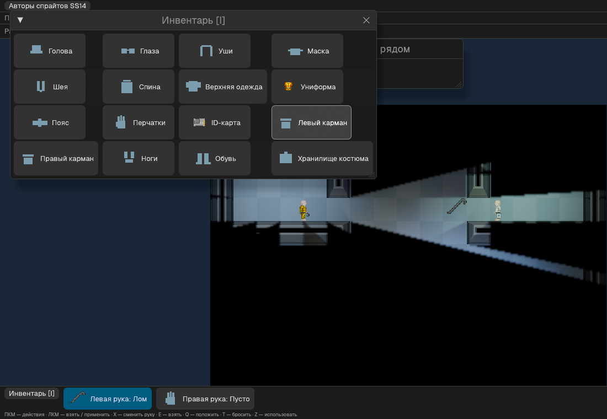

# Спрайты SS14 — 23 ноября 2026

В прототип подключены реальные RSI-ресурсы SS14: тело человека, форма инженера,
врача и ассистента, шлем, фонарь, лом, аптечка, ID-карты и ящик.
11 наборов содержат 152 состояния PNG и 11 meta.json. Исходные файлы не изменены.
Происхождение и SHA-256 каждого файла: [MANIFEST.json](assets/ss14/MANIFEST.json).
Авторы и лицензии: [ATTRIBUTION.md](assets/ss14/ATTRIBUTION.md).
Это CC BY-SA 3.0, отдельно от MIT-кода; уведомления также доступны кнопкой
«Авторы спрайтов SS14» в игре и редакторе.

## Что работает

- Загрузка RSI v1: размеры кадров, именованные состояния, 1/4/8 направлений,
  индивидуальные длительности кадров по направлениям и циклическая анимация.
- Один RGBA-атлас 2048×2048, nearest sampling, прозрачность и порядок слоёв.
  Спрайты лежат в плоскости строго верхней ортографической камеры и участвуют
  в освещении, видимости и выборе палубы существующего 3D-мира.
- Сервер собирает тело, одежду, шлем и обе руки. Смена активной руки не удаляет
  предмет из другой руки. Снятие одежды, бросок и отключение игрока обновляют вид.
- Форма выдаётся вместе с комплектом профессии. Для базового персонажа остаётся
  нейтральный нижний слой одежды; редактора внешности пока нет.
- Состояния предметов: включённый фонарь, открытый ящик, искры при работе с замком.
- Инвентарь, руки и заголовок контекстного меню используют иконки из того же атласа.
- Редактор показывает спрайты прототипов и сохраняет их описания в JSON карты.
- Протокол v7 передаёт серверные слои и направление. PNG по сети не передаются:
  оба клиента должны иметь одинаковый набор ресурсов.

## Где находится код

| Часть | Файл |
|---|---|
| RSI, PNG, атлас, выбор кадра | `../crates/horizon-client-render/src/station_sprite.rs` |
| Типы слоёв | `../crates/horizon-client-render/src/station_sprite_types.rs` |
| Встраивание ресурсов | `../crates/horizon-client-render/src/station_sprite_assets.rs` |
| Отрисовка | `../crates/horizon-client-render/src/station_renderer.rs`, `station.wgsl` |
| Серверная сборка внешности | `sim/src/appearance.rs`, `sim/src/actors.rs` |
| Иконки и авторы | `client/src/sprites.rs` |
| Прототипы и комплекты | `content/station.json` |

`character.layers` задаёт базовые слои. `prototypes.<id>.sprite` содержит
`layers`, `active_layers`, `open_layers`, `working_layers`, `worn`,
`inhand_left`, `inhand_right`. Слой задаёт `rsi`, `state`, RGBA `color`,
`offset` и `scale`. `sprite_size` — множитель естественного размера RSI (32 пикселя на клетку).
Неизвестное состояние отображается пурпурной клеткой; неверный RSI отклоняется.

Для своих ресурсов установите `STATION_SPRITE_DIR` в каталог с папками
`name.rsi/meta.json` и PNG. Совпадающие имена файлов заменяют встроенные;
новые имена добавляются. Нажмите F5 в игре или редакторе после изменения. Ошибочная загрузка оставляет прежний атлас. Ограничения:
64 записи корневого каталога, 513 записей на RSI, 8 МиБ на файл,
32 МиБ суммарно внешних файлов, кадр до 128×128, до 512 состояний на RSI.
Переполнение атласа и неверные данные дают ошибку загрузки.

## Перенос через rust-anything

Из RobustToolbox перенесён именно алгоритм `RSIResource.FoldDelays`:
сведение разных временных шкал направлений в общую последовательность кадров.
Источник: `Robust.Client/ResourceManagement/ResourceTypes/RSIResource.cs`,
ревизия `1afd6929b473dd537b42cb668a961c84a2e2e7c6`.
История метода и MIT-уведомление сохранены в
`ss14-port/reference/RSI-FoldDelays.cs.txt`; [юридическая справка](ss14-port/ROBUST-LEGAL.md).

`ss14-port/sprite-oracle/Rules.cs` содержит исходный C#-алгоритм и ограничивающий
входные данные адаптер. `ss14-sprite-rules/src/port.rs` — его Rust-эквивалент.
rust-anything 3.3.0 записал C#-ответы, построил мост и сравнил 358 случаев,
включая несовпадающие длительности направлений, 1/4/8 направлений и ошибки.
Сравниваются даже биты float длительностей. [Gate: 358/358](ss14-port/SPRITE-GATE.json).
В игре используется непосредственно Rust; .NET нужен только для повторной проверки.

Загрузчик, GPU-атлас и интеграция с нашим сервером написаны для этого прототипа.
Расширенная система компонентов, слоёв, масок, событий, индивидуальной анимации,
Appearance и составных иконок описана в [SPRITE-SYSTEM.md](SPRITE-SYSTEM.md).
По согласованному объёму используется наш JSON-формат; загрузчик YAML и язык
шейдеров RobustToolbox не включены. Статические кадры тела не заменены новой
анимацией ходьбы. `AdvanceFrameAnimation` дополнительно перенесён через
rust-anything: [425/425](ss14-port/PLAYBACK-GATE.json).

## Проверка

Из корня Horizon:

```powershell
cargo test --manifest-path station/Cargo.toml --workspace --locked --offline
cargo clippy --manifest-path station/Cargo.toml --workspace --all-targets --locked --offline -- -D warnings
cargo build --manifest-path station/Cargo.toml --workspace --locked --offline
station/verify-sprites.ps1 -ScratchRoot C:/path/to/scratch
station/ss14-port/verify-sprite.ps1 -RustAnything C:/path/to/rust-anything.exe
```

85 тестов прошли: render 20, client 7, server 15, sim 43.
Проверены кадры и направления, анимация искр, отсутствие потерянных ссылок на
состояния, ошибочные RSI, одежда/шлем/руки и удаление сетевого персонажа.
GPU smoke прошёл в редакторе и двух отдельных TCP-клиентах: инженер и врач
достали предметы из карманов настоящими UI-кликами; оба клиента получили слои
формы и рук, скрыли соседа за дверями и показали его после открытия.
Во время движения камеры повторных загрузок геометрии не было.
Логи и изображения: [evidence/sprites](evidence/sprites).



## Стены, свет и инвентарь

Стены и закрытые двери собираются из четырёх угловых RSI-слоёв.
Соседи по сторонам и диагонали выбирают `wall0/1/2/5/6`: торец, продолжение,
внутренний угол или заполненное соединение. Изменение клетки обновляет также
соседние чанки, поэтому стыки обновляются после удаления стены и открытия двери.
Меши остаются закэшированными. Исходные PNG и meta.json solid.rsi сохранены целиком;
авторы rye-rice, 20nypercent, AftrLite, CC BY-SA 3.0. Разметка углов следует
[формату CardinalCorner SS14](https://github.com/space-wizards/space-station-14/blob/f5b48b6547a1f9bfd1f1613d879d68064e22f57f/Content.Client/IconSmoothing/Smoothings/CardinalCornerSpriteSmoothing.cs).

Свет рассчитывается compute-шейдером на GPU в поле 512×512, затем сглаживается
кубической B-spline выборкой. CPU больше не выполняет обход лучами для каждого
пикселя карты света в потоке отрисовки. Точная проверка видимости сущностей
остаётся на CPU, независимо от визуального сглаживания.
Код: `../crates/horizon-client-render/src/station_light_gpu.rs`,
`station_light_gpu.wgsl`, `station.wgsl`. GPU-тест сравнивает 2883 точки с
эталонными CPU-проверками видимости и затухания, включая проём и углы.

Причина прежних пауз и замеры: [PERFORMANCE.md](PERFORMANCE.md).

Инвентарь — сетка 4×4 с увеличенными иконками предметов, пиктограммами пустых
слотов и подсказками с названием содержимого. Пустые руки также имеют пиктограммы.
Оригинальные пиктограммы генерируются в `client/src/sprites.rs` и имеют MIT-лицензию.
Стандартная NC-тема слотов SS14 не включалась. ЛКМ и ПКМ продолжают отправлять
прежние серверные команды; проверки расстояния и владения остаются на сервере.

Проверено после обновления: сборка, Clippy, тесты света/рендерера/клиента,
редактор и два TCP-клиента с UI-кликами. Новый тест проверяет сохранение фонового
света фильтром, плавную границу и отсутствие видимости за сплошной стеной.
Скриншоты в `evidence/sprites` обновлены реальным GPU-запуском.
